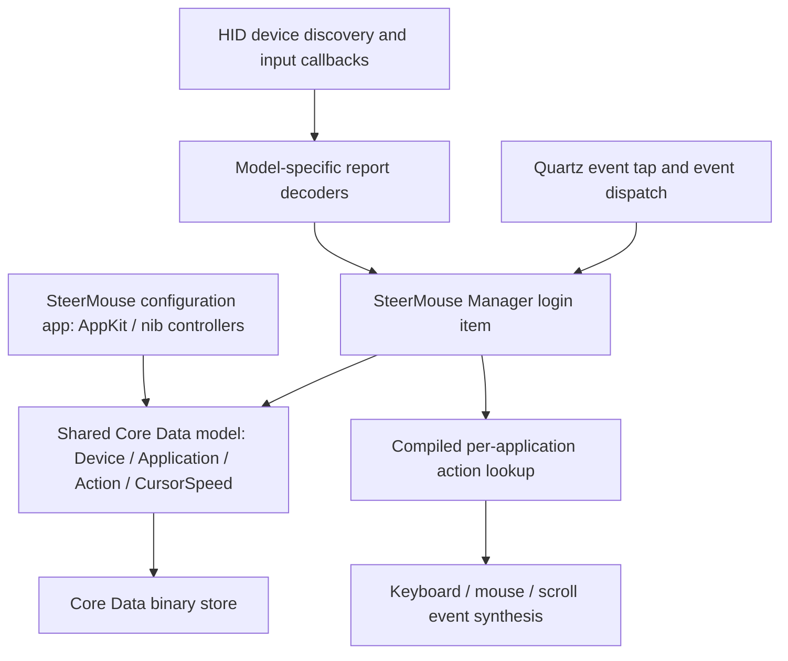

# SteerMouse architecture: recovered map

This report maps the installed 5.8 binary using REA artifact/Mach-O/UI evidence and focused arm64 assembly inspection. It is a bounded reverse-engineering result, not the original source code or a fully validated replica.

## Components

The diagram summarizes recovered components and traced paths. It does not claim that every event follows one linear path; callbacks, queues, timers and app-specific branches remain involved. The main app also imports HID support; the UI/helper split is not an assertion that only the helper can access devices.

The main bundle is `jp.plentycom.app.SteerMouse`; its login-item helper is `jp.plentycom.boa.SteerMouse`. Both have x86_64/arm64 slices and declare macOS 12 minimum. The helper is an `LSUIElement` app. Code-signing inspection observes Plentycom's team `UHEB36849R` and hardened-runtime metadata; this is not an independent assessment of trust or successful launch.

## What has actually been recovered

| Question | Result | Boundary |
| --- | --- | --- |
| What runs in the background? | A bundled login-item manager with HID callbacks, event taps, event synthesis and shared settings classes | Static code and package evidence; lifecycle/running branches unverified |
| How does the interface connect to code? | Five nib documents decoded; selected controls cross-checked to native Objective-C implementations | Packaged connections, not executed action traces |
| What stores profiles? | Core Data `NSBinaryStoreType`, shared versioned `.momd` schema and migration options | Transformable payload semantics and real-user migrations unverified |
| Why can transport profiles split? | Device lookup includes VID/PID/MID/transport; alias normalization occurs before lookup | Exact static branch; hardware/profile migration untested |
| How are button actions looked up? | Compiled records and ordered fallback searches over button/scroll/modifier keys | Assembly-derived behavior, not complete action execution semantics |
| Are Naga side buttons ordinary mouse buttons? | USB path has keyboard-report decoding into internal side-button indices | Bluetooth event behavior and onboard assignments not established |
| How are custom hardware models represented? | Packaged plist definitions and user-definition loading/matching paths | No definition installed or altered |

Details: [UI map](ui-architecture.md), [input pipeline](input-pipeline.md), [profile architecture](profile-architecture.md), [static evidence](static-findings.md).

## REA identities

| Capture | Evidence ID |
| --- | --- |
| Main Mach-O | `ev_3c3ce291c1ec2c43ae4ede398a6bc17efae6da8a17c92fcd34ffa89346899f40` |
| Main bundle plist | `ev_12b741316469e39d63af46a1e7aabe1fec5e27a6bb042259df08535adf9aeb96` |
| Main signature metadata | `ev_3fd59de9259b93778ce68edf1e9751cbee801e2439ced926edce4006a190ba1d` |
| Helper Mach-O | `ev_810a7737ed18341cf02d672cef4cd779efede256fe3432130ea48b641823d223` |
| Helper bundle plist | `ev_be11d724aa193c12a31e8c5b22cb22bef734e1052827963058ba568f835cf482` |
| Helper signature metadata | `ev_ddbe844b014f5d1d6c7a6166a0885942645019df6f816f133582576c6e794c83` |

REA recovered 349 main import items and 354 helper import items with `exhaustive=false`; those counts must not be described as complete import recovery. Architecture enumeration reports two slices per executable with exhaustive coverage. Relevant arm64 implementation addresses are tied to the exact executable hashes in the static report. REA signature entitlements are `null` (unestablished), not proof of an empty entitlement set.

## Remaining reverse-engineering work

- Complete action payload decoding and execution semantics, including chords and shortcut sequences.
- Recover pointer/scroll acceleration equations, smoothing state, timer behavior and edge cases.
- Trace Bluetooth-specific Naga decoding and correlate physical-button input with actual reports.
- Complete distributed-notification command semantics, cache invalidation, shutdown restoration and concurrent settings changes. The release/reload branch itself is recovered in the profile report.
- Corroborate reconstructed behavior using a deep analysis engine and bounded runtime observations.

No Hopper/Ghidra/IDA provider is available in this environment. This pass therefore uses native disassembly, surviving Objective-C metadata and REA's provider-independent inspection. Handwritten pseudocode in the detailed reports is an interpretation of assembly, not decompiler output or recovered source. Unknown branches remain explicit.
